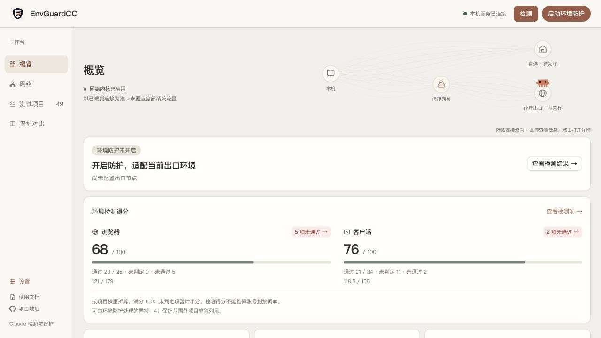
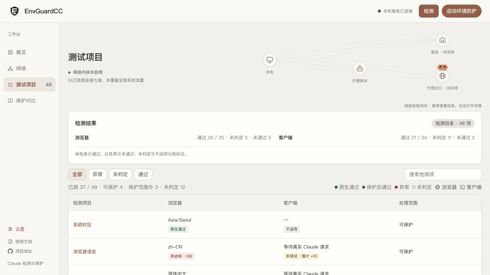
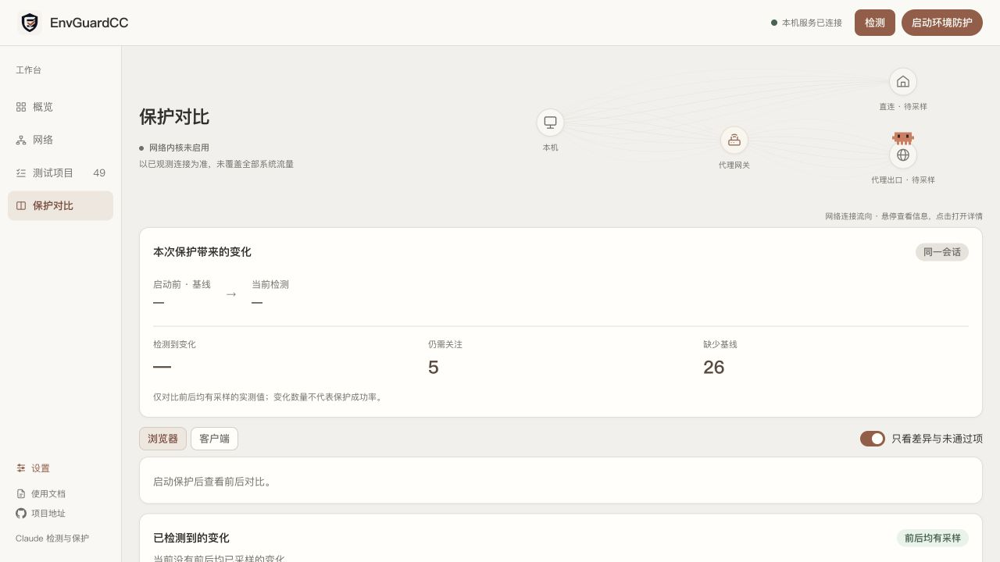
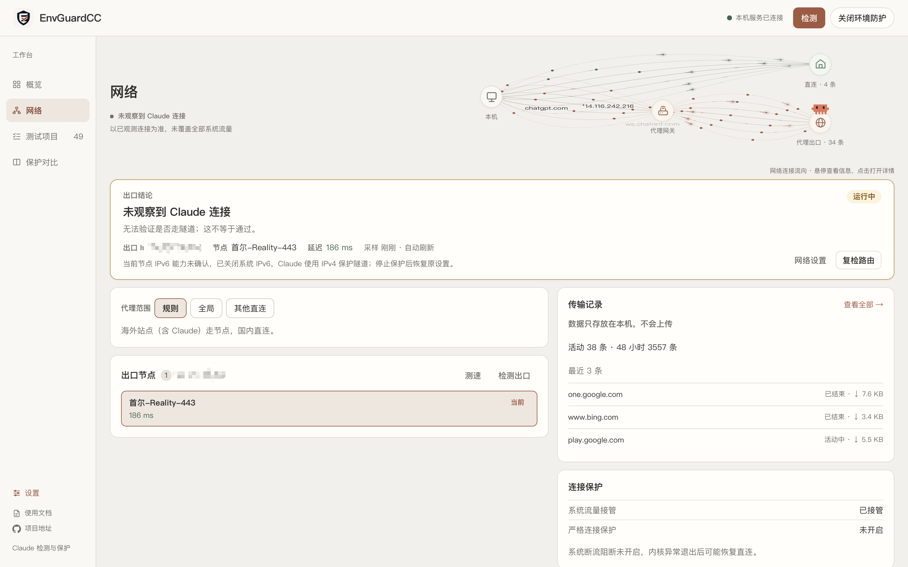

# EnvGuardCC

A Claude runtime environment inspection and protection workspace with browser and client diagnostics, protection settings, and before-and-after comparisons.

[中文](README.md) · [GitHub](https://github.com/AACS111/EnvGuardCC) · [Issues](https://github.com/AACS111/EnvGuardCC/issues)

## Download

- [Apple Silicon Mac DMG](https://github.com/AACS111/EnvGuardCC/releases/download/v0.2.4/EnvGuardCC-0.2.4-arm64.dmg)
- [Apple Silicon Mac ZIP](https://github.com/AACS111/EnvGuardCC/releases/download/v0.2.4/EnvGuardCC-macOS-arm64.zip)
- [Windows x64 installer (.exe)](https://github.com/AACS111/EnvGuardCC/releases/download/v0.2.4/EnvGuardCC-Setup-0.2.4.exe)
- [Windows x64 portable package (.zip)](https://github.com/AACS111/EnvGuardCC/releases/download/v0.2.4/EnvGuardCC-Windows-x64.zip)
- [SHA-256 checksums](https://github.com/AACS111/EnvGuardCC/releases/download/v0.2.4/SHA256SUMS.txt) · [All releases](https://github.com/AACS111/EnvGuardCC/releases)

Run the installer directly, or extract the entire portable package and launch EnvGuardCC.exe with its accompanying files. Both packages include Node.js. Windows also needs system WebView2; the installer downloads it when missing, while portable users must install it first. The installer is not code-signed.


> Version 0.2.4 uses Tauri 2 with the system WebView and bundled Node.js for smaller desktop packages.

## Screenshots

The screenshots below show the Chinese workspace shared by desktop and local web modes. Screenshots use an isolated setup; the network screenshot was supplied with its exit IP redacted. Sample values do not guarantee protection results.

### Overview

Review browser and client indicators, network exit details, protection settings, and anomalies.



### Checks

Filter checks by status and inspect browser and client measurements.



### Protection comparison

Compare the baseline with current measurements and distinguish passed, failed, and unverified results.



### Network

Manage nodes, routing, transfer records and connection protection.



## Features

- Browser and Claude client diagnostics covering timezone, language, fonts, device signals, and network exit.
- Exit IP, region, operator, and network type identification with explicit unknown states.
- Protection controls, scheduled checks, and per-check configuration details.
- Claude domains are blocked while protection is off, so Claude cannot be used in an unprotected state; enable protection to use it again.
- Before-and-after comparisons that distinguish native passes, passes after protection, failures, and unknowns.
- Configuration backups and restoration during normal shutdown, with retained backups and errors when restoration fails.
- Windows x64 and Apple Silicon desktop packages, plus local web and source development modes.
- A lower-left Updates entry checks stable GitHub Releases at startup and every 6 hours, with manual rechecks, platform downloads and Markdown release notes.

Indicators describe the measured environment. They are not actual suspension probabilities and do not guarantee account or third-party service availability.

## Run locally

Requires Node.js 20+ and pnpm. Windows desktop and system-setting operations also require PowerShell 7.

### macOS (Apple Silicon, source development)

Use the `develop` branch for development, and read [CONTRIBUTING.md](CONTRIBUTING.md) before opening a pull request.

```bash
pnpm install --frozen-lockfile
pnpm dev:tauri
```

Desktop development requires Rust and native build tools; the first compilation downloads Rust dependencies. Desktop mode uses local port 3030 for its interface. Quitting from the tray or with `Cmd+Q` exits the app and attempts to restore configuration and release ports opened by that launch.

For the local web interface only:

```bash
pnpm dev
```

Open the local URL printed by the terminal.

### Windows

Apple Silicon Mac packages are available above. The commands below are for Windows; see the macOS source-development steps for local development.

```powershell
git clone https://github.com/AACS111/EnvGuardCC.git
cd EnvGuardCC
git switch develop
pnpm install --frozen-lockfile
pnpm dev:tauri
```

For the local web interface only:

```powershell
pnpm dev
```

Open the local URL printed by the terminal. Desktop mode uses port 3030 for its interface. Desktop development requires Rust and native build tools; the first compilation downloads Rust dependencies.

## Supported scope

The bundled mihomo kernel accepts user-provided subscriptions or self-hosted nodes and provides a local HTTP/SOCKS proxy plus a separate system-capture switch. Another proxy client is not required. System capture is off on first launch; enabling TUN requires system authorization and saves that choice. Daily proxy use is independent of environment adaptation. Third-party proxy client configurations are not modified.

macOS now has optional strict connection protection: pin all outbound traffic to one node and use independent PF rules to block other paths, retaining the block after the kernel exits. Explicitly disable strict mode or use the recovery tool to restore networking. Enabling reconnects existing connections and blocks ordinary LAN traffic and unauthenticated local proxy access. Only checked system PF layouts are supported. Windows does not yet have a WFP system filter; ordinary proxy mode does not retain a crash-time block. These features do not guarantee Claude service eligibility or account outcomes.

See the [implementation and verification record](docs/NETWORK-SAFETY-IMPLEMENTATION.md) for actual package, native TUN, blocking and recovery test coverage. Managed browsers and authorized timezone changes/restoration remain separate features; macOS Claude desktop is opened normally.

Apple Silicon packages use ad-hoc signing and are not notarized. First launch may need approval in System Settings > Privacy & Security. Build outputs are written to `node_modules/.checkcc-dist`; see the [Mac verification record](docs/MACOS-STAGE4-RESULTS.md) for tested environments and remaining limits.

## Build and verify

```powershell
pnpm lint
pnpm test:desktop
pnpm test:shutdown
pnpm test:protection
pnpm build
pnpm desktop:installer
```

`desktop:installer` builds a Windows installer on Windows or a DMG on macOS arm64. The Mac DMG includes EnvGuardCC, an Applications shortcut and bilingual instructions. Drag the app into Applications, then launch it there. The packaging command prints its output location.

## Stack

Next.js 16, React 19, TypeScript, Tailwind CSS 4, and Tauri 2.

## License

MIT. See [LICENSE](LICENSE).

### System timezone authorization

On macOS 13+, the first protection activation requests system approval to bind its restricted timezone service. Subsequent changes and restoration reuse that service automatically. Source/ad-hoc builds are supported without end-user developer certificates. There is no connection or service-management panel. See [timezone service details](docs/timezone-service.md).

### Desktop startup and background operation

Installed Windows and macOS apps offer launch-at-login and automatic protection switches in Protection configuration. Development previews do not register login items. Closing the window keeps protection running in the background; quitting from the tray or app menu restores configuration before exiting. On launch the tray icon and window appear first while the network kernel and "enable protection on startup" keep running in the background: the first start waits for the privileged host, brings up the TUN and verifies the exit, so the network page shows "Starting" until it finishes; quitting does not wait for these background steps.

### Reset Claude Desktop

The Protection configuration action resets supported local Claude Desktop data locations after protection is stopped and Claude and its background tasks are closed. Review the native confirmation first: sign-in state, caches, preferences, MCP configuration and local Cowork/Desktop session data are moved to the system Trash/Recycle Bin and remain recoverable until it is emptied. Unknown locations, redirected paths, locks and permission errors are reported instead of claiming a complete reset. The app, browser profiles, Claude Code, projects, cloud records and unrelated credential-manager entries are preserved. This does not change device identity or guarantee removal of server-side account associations. Check onboarding and sign-in after reopening Claude; use Claude’s built-in Reset Application Data for unsupported storage layouts.

Monitoring and its interval are saved locally before a change is acknowledged and survive app restarts and protection stop/start cycles. Save failures are reported without changing the active settings. Launch-at-login and automatic protection preferences are also retained.

Tauri 2 desktop development requires Rust stable, Windows C++ Build Tools and Windows SDK, or Xcode Command Line Tools on macOS. See [desktop architecture and validation](docs/TAURI-DESKTOP.md).

## Updates

Publish a higher `v<version>` stable GitHub Release with the matching platform packages to make it discoverable. Drafts and prereleases are excluded. The app distinguishes missing packages, unsupported platforms and failed checks, and does not automatically install or restart. Quit normally and wait for configuration restoration before installing an update. Forks can set the backend environment variable `CHECKCC_UPDATE_REPOSITORY=owner/repository` to use their own public releases with the existing asset names.

See the [0.2.4 release notes](docs/releases/v0.2.4.md).
