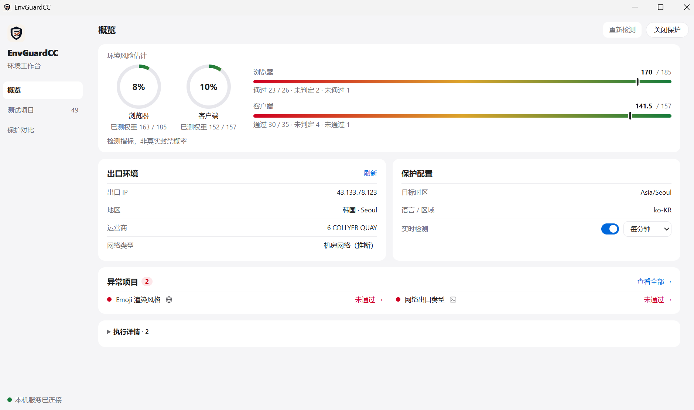
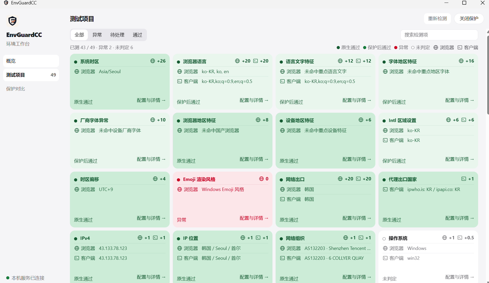
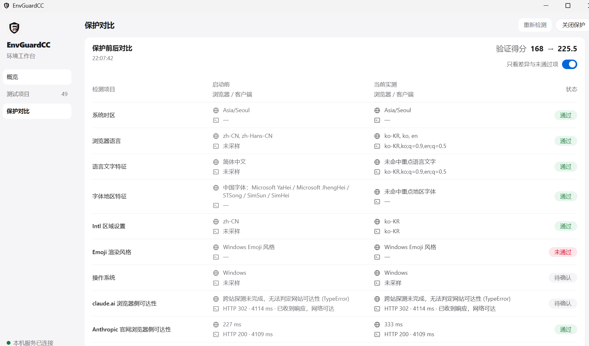

# EnvGuardCC

Claude 运行环境检测与保护工作台，支持浏览器与客户端环境分析、保护配置以及前后对比。

[English](README.en.md) · [GitHub](https://github.com/AACS111/EnvGuardCC) · [问题反馈](https://github.com/AACS111/EnvGuardCC/issues)

## 下载

- [Windows x64 安装包（.exe）](https://github.com/AACS111/EnvGuardCC/releases/download/v0.1.3/EnvGuardCC-Setup-0.1.3.exe)
- [Windows x64 便携包（.zip）](https://github.com/AACS111/EnvGuardCC/releases/download/v0.1.3/EnvGuardCC-Windows-x64.zip)
- [Apple Silicon Mac 安装镜像（.dmg）](https://github.com/AACS111/EnvGuardCC/releases/download/v0.1.3/EnvGuardCC-0.1.3-arm64.dmg)
- [Apple Silicon Mac 应用（.zip）](https://github.com/AACS111/EnvGuardCC/releases/download/v0.1.3/EnvGuardCC-macOS-arm64.zip)
- [SHA-256 校验值](https://github.com/AACS111/EnvGuardCC/releases/download/v0.1.3/SHA256SUMS.txt) · [全部版本](https://github.com/AACS111/EnvGuardCC/releases)

安装包下载后直接运行；便携包请完整解压后运行 EnvGuardCC.exe，保留同目录运行文件。均已包含 Node.js 运行环境。Windows 还需系统 WebView2；安装器在缺失时联网安装，便携版需先安装 WebView2。安装包尚未进行代码签名。


> 0.1.3 桌面客户端采用 Tauri 2，使用系统 WebView 并内置 Node.js，安装包体积更小。

## 界面预览

### 概览

查看浏览器与客户端的检测指标、出口环境、保护配置及异常项目。



### 测试项目

按全部、异常、待处理和通过筛选检测项，查看两端采样值与配置详情。



### 保护对比

对比启动前与当前实测结果，区分通过、未通过与待确认。



## 功能

- 浏览器与 Claude 客户端环境检测，覆盖时区、语言、字体、设备特征及网络出口。
- 出口 IP、地区、运营商和网络类型识别，未知结果保留为未判定。
- 启停环境保护、定时复检及逐项配置说明。
- 保护前后对比，展示原生通过、保护后通过、异常与未判定。
- 修改前保存原始配置，正常退出时尝试恢复；失败时保留备份和真实原因。
- Windows 桌面应用、macOS 源码开发模式与本地网页运行模式。

检测指标仅用于环境分析，不代表真实封禁概率，也不保证账号或第三方服务可用性。

## 参与开发

稳定版本使用 `main`，日常开发与 PR 集成测试使用 `develop`。开发前请阅读 [贡献指南](CONTRIBUTING.md)。

## 本地运行

需要 Node.js 20+ 和 pnpm。Windows 的桌面应用与系统设置操作另需 PowerShell 7。

### macOS（Apple Silicon，源码开发）

请先切换到包含 macOS 适配的 `develop` 分支，再执行以下命令。

```bash
pnpm install --frozen-lockfile
pnpm dev:tauri
```

桌面开发需安装 Rust 与平台构建工具，首次编译会下载 Rust 依赖。桌面模式使用本机 3030 页面端口；`Cmd+Q` 或从托盘退出会结束应用，并在退出时尝试恢复配置、释放本次启动占用的端口。

只运行本地网页：

```bash
pnpm dev
```

启动后使用终端显示的本机地址。

### Windows

以下命令用于 Windows；Apple Silicon 可下载上方 Mac 安装包，或使用 macOS 源码开发步骤。

```powershell
git clone https://github.com/AACS111/EnvGuardCC.git
cd EnvGuardCC
pnpm install
pnpm dev:tauri
```

只运行本地网页：

```powershell
pnpm dev
```

启动后使用终端显示的本机地址。桌面模式使用本地 3030 页面端口；桌面开发需安装 Rust 与平台构建工具，首次编译会下载 Rust 依赖。

## 平台支持范围

macOS 自动跟随系统 HTTP/HTTPS 代理或系统路由（含 TUN），无需在应用内手动配置代理。应用不读取或改写第三方代理软件的订阅、策略组或路由配置。受控浏览器、系统时区修改与恢复均使用独立的通用功能；Claude 桌面端仅提供普通打开。

已生成 Apple Silicon 本地试用包（`.app`、ZIP、DMG，ad-hoc 签名），产物在 `node_modules/.checkcc-dist`；`pnpm desktop:package` 生成 `.app` 和 ZIP，`pnpm desktop:installer` 再生成 DMG。按当前交付定位不申请 Developer ID 和公证，其他 Mac 首次打开需在系统设置 > 隐私与安全性中授权；已安装到本机 `/Applications`，异机验证仍未完成。当前实测为 Apple Silicon、macOS 27.0，不据此声明更旧系统或 Intel 支持。详见 [阶段四结果](docs/MACOS-STAGE4-RESULTS.md)。

## 构建与验证

```powershell
pnpm lint
pnpm test:desktop
pnpm test:shutdown
pnpm test:protection
pnpm build
pnpm desktop:installer
```

`desktop:installer` 在 Windows 上生成安装程序，在 macOS arm64 上生成 DMG。Mac DMG 包含 EnvGuardCC、Applications 快捷入口及中英文安装说明；将应用拖入 Applications 后，从“应用程序”启动。具体目录见打包命令输出。

## 技术栈

Next.js 16、React 19、TypeScript、Tailwind CSS 4、Tauri 2。

## 许可证

MIT，详见 [LICENSE](LICENSE)。

### 系统时区授权

macOS 13 及以上在首次开启保护时通过系统弹窗绑定时区辅助服务，此后修改和恢复时区自动复用授权。支持开源源码构建，不要求使用者拥有开发者证书；页面不显示连接方式或服务管理面板。详见 [时区服务说明](docs/timezone-service.md)。

### 桌面启动与后台运行

Windows 和 macOS 安装版可在“保护配置”中设置开机自启动（登录系统后后台启动）及启动后自动开启保护。开发预览不注册系统自启动。点击窗口关闭按钮会保留后台运行和当前保护；从托盘或应用菜单退出时会先恢复配置。

### Claude 恢复初始化

“保护配置”中的“Claude 恢复初始化”用于重置官方桌面客户端的本地应用资料。先关闭保护、退出 Claude 和后台任务，再查看确认窗口列出的清理位置。支持 macOS 常用应用资料位置，以及 Windows 普通安装和已识别的 MSIX 资料目录；遇到未知位置、符号链接、锁定或权限问题会停止并报告，不声明已全部清除。

登录状态、缓存、偏好、MCP 配置及本地 Cowork/桌面会话数据将移至系统废纸篓/回收站；清空前仍可恢复。此操作保留 Claude 程序、浏览器、Claude Code、用户项目和云端数据；不修改设备标识，不处理系统凭据管理器中的其他记录，也不保证解除服务端账号关联。重新打开 Claude 后检查初始设置和登录状态；若版本使用其他存储位置，请使用 Claude 自带的“重置应用数据”。

实时检测开关与检测间隔修改成功后会立即保存到本地，退出重启、关闭和重新开启保护都会保留。若保存失败，页面会显示错误并保留原有配置。开机自启动与启动后自动开启保护也分别保存。
