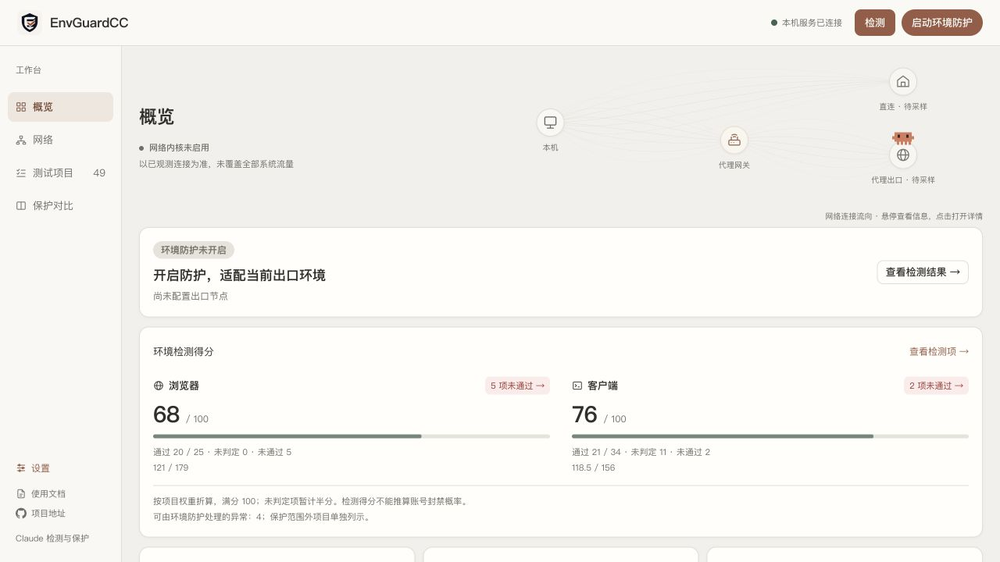
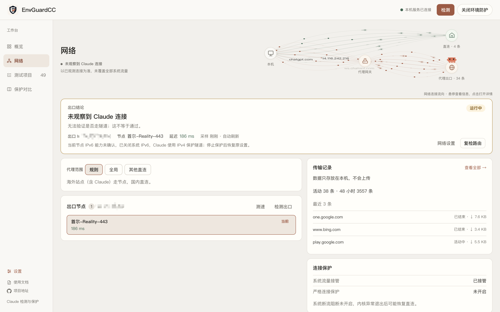
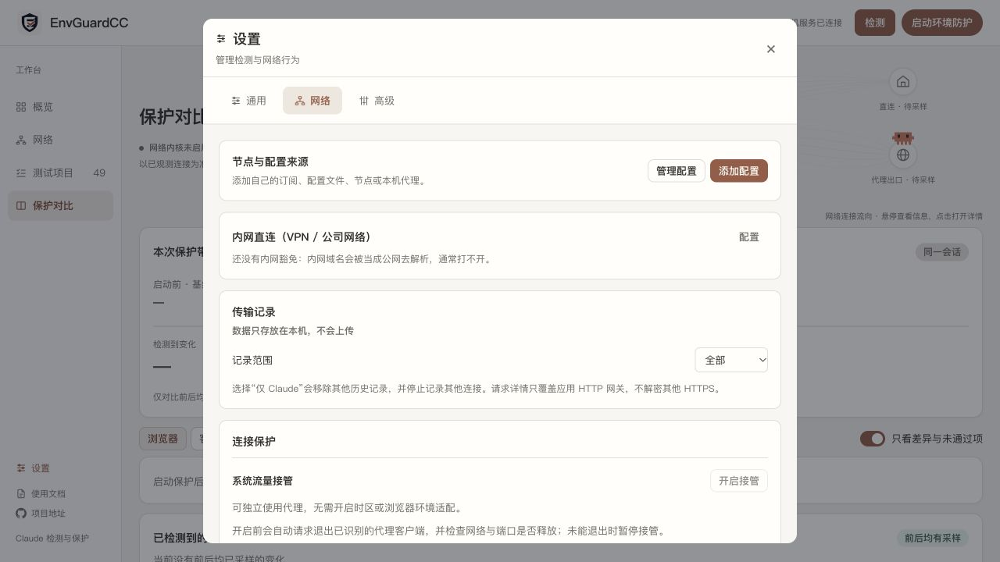
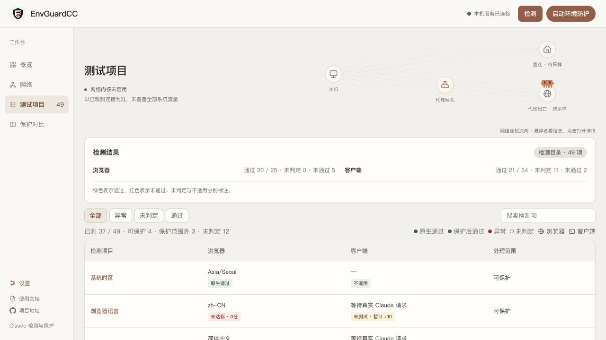
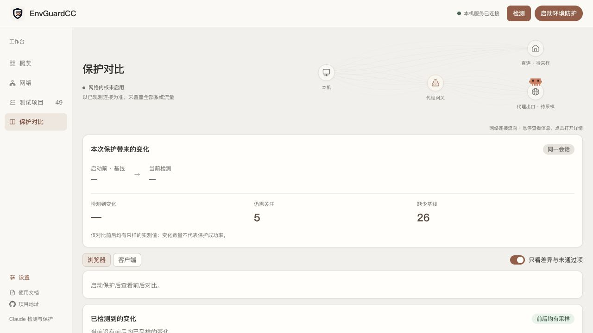
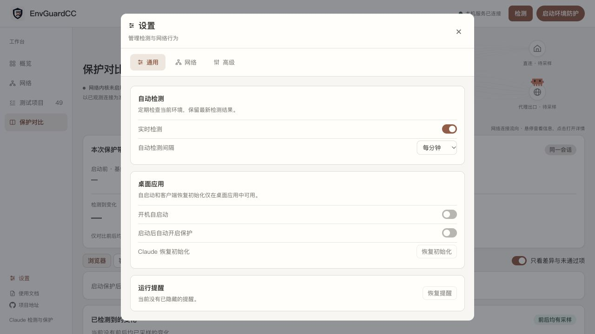
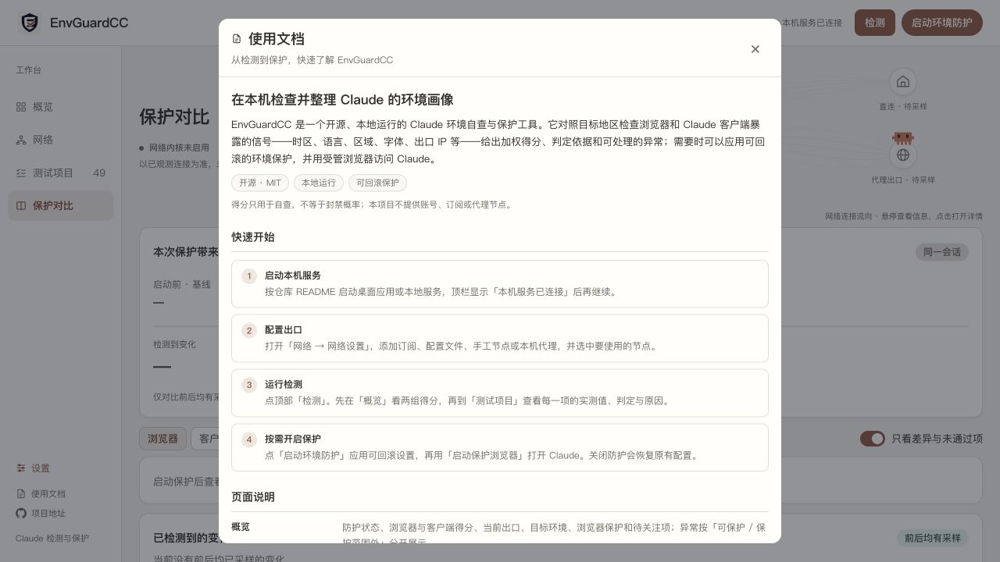

# EnvGuardCC

**开源、本地运行的 Claude 环境检测与保护工作台。**

在一个界面中检查浏览器与 Claude 客户端的环境信号、管理网络出口、应用可回滚的环境防护，并查看保护前后的实测变化。

[English](README.en.md) · [下载安装](#下载安装) · [快速开始](#快速开始) · [App 界面与操作](#app-界面与操作) · [源码运行](#源码运行) · [问题反馈](https://github.com/AACS111/EnvGuardCC/issues)



> 检测得分用于环境自查，不等于账号封禁概率，也不保证登录、订阅或账号状态。本项目不提供 Claude 账号、订阅或代理节点。

## 能做什么

| 能力     | 说明                                                                                                     |
| -------- | -------------------------------------------------------------------------------------------------------- |
| 环境检测 | 对照目标环境检查时区、语言、区域、字体、设备特征、WebRTC、DNS 和网络出口，分别展示浏览器与客户端的结果。 |
| 出口管理 | 内置 mihomo，支持自己的订阅、配置文件、手工节点或本机代理；查看节点延迟、实际出口 IP、地区及出口变化。   |
| 环境防护 | 根据已核验出口适配可处理的环境配置；保留原始配置和恢复记录，支持受管浏览器。                             |
| 检测证据 | 查看每一项的采样值、判定依据和处理范围，区分原生通过、保护后通过、异常与未判定。                         |
| 保护对比 | 对比同一会话中的启动前基线与当前采样，列出实测变化、仍需关注和缺少基线的项目。                           |
| 连接保护 | 系统流量接管可独立于环境防护使用；macOS 另提供可选的严格连接保护。                                       |
| 本地运行 | 桌面端使用 Tauri 2，内置 Node.js；源码可自行构建、审查和运行，无需项目私有云服务。                       |

## 下载安装

当前版本：**0.2.1**。下载其他版本或查看发布说明，请前往 [GitHub Releases](https://github.com/AACS111/EnvGuardCC/releases)。

| 平台                  | 安装包                                                                                                    | 其他形式                                                                                              |
| --------------------- | --------------------------------------------------------------------------------------------------------- | ----------------------------------------------------------------------------------------------------- |
| Windows x64           | [EXE 安装器](https://github.com/AACS111/EnvGuardCC/releases/download/v0.2.1/EnvGuardCC-Setup-0.2.1.exe)   | [便携 ZIP](https://github.com/AACS111/EnvGuardCC/releases/download/v0.2.1/EnvGuardCC-Windows-x64.zip) |
| macOS · Apple Silicon | [DMG 安装镜像](https://github.com/AACS111/EnvGuardCC/releases/download/v0.2.1/EnvGuardCC-0.2.1-arm64.dmg) | [应用 ZIP](https://github.com/AACS111/EnvGuardCC/releases/download/v0.2.1/EnvGuardCC-macOS-arm64.zip) |

[SHA-256 校验值](https://github.com/AACS111/EnvGuardCC/releases/download/v0.2.1/SHA256SUMS.txt)

- **Windows**：运行安装器，或完整解压便携包后运行 `EnvGuardCC.exe`，保留同目录文件。需要系统 WebView2；安装器会在缺失时联网安装，便携版需自行准备。安装包尚未进行代码签名。
- **macOS**：打开 DMG，将应用拖入 Applications，再从“应用程序”启动。当前采用 ad-hoc 签名，尚未进行 Developer ID 签名和公证；首次打开可能需要在“系统设置 → 隐私与安全性”中允许。
- 两个平台的桌面包均内置 Node.js，最终用户无需另装 Node.js 或单独安装 mihomo。

## 快速开始

1. **启动应用**：等待右上角显示“本机服务已连接”。
2. **添加自己的出口**：打开“网络 → 网络设置 → 添加配置”，导入订阅、配置文件、节点或本机代理，并选中要使用的节点。
3. **检查出口**：在“网络”查看延迟与实际出口检测结果。节点名称不能证明出口地区；不支持的出口地区会阻止环境防护启动。
4. **运行检测**：点击顶栏“检测”，先在“概览”查看浏览器与客户端得分，再到“测试项目”检查异常与未判定项。
5. **按需开启环境防护**：点击“启动环境防护”，按系统提示完成所需授权；使用“启动保护浏览器”打开受管浏览器访问 Claude。
6. **检查效果并退出**：在“保护对比”查看实测变化。关闭环境防护会尝试恢复原始环境配置；要结束后台运行，请从托盘或应用菜单退出。

首次使用默认不开启系统流量接管。开启接管前，应用会请求正常退出已识别的代理客户端并检查冲突；未能释放网络资源时会暂停接管。建议先阅读下方[平台与保护边界](#平台与保护边界)。

## App 界面与操作

以下截图更新于 **2026-11-09**。网络页采用用户提供的运行中界面截图，节点出口 IP 与配置名称已打码；其余截图从 `develop` 当前源码的本地网页模式截取，展示与桌面端共用的工作台界面，使用未导入节点、未开启环境防护的隔离配置。可见检测值来自各自会话的当次采样。开发分支界面可能与已发布安装包不同。

### 顶栏与导航

| 入口                              | 用途                                                                             |
| --------------------------------- | -------------------------------------------------------------------------------- |
| 本机服务状态                      | 确认本机助手与后台是否连接；未连接时部分操作不可用。                             |
| 检测                              | 重新采样环境；按钮在运行时显示“检测中…”。                                        |
| 启动 / 关闭环境防护               | 应用可回滚的保护设置，或从备份恢复原始配置。                                     |
| 概览 / 网络 / 测试项目 / 保护对比 | 切换四个工作页面。                                                               |
| 设置                              | 打开通用、网络和高级设置。                                                       |
| 检查更新                          | 查看当前版本、最新正式版本与更新说明；有匹配安装包时显示“可更新”，提供下载入口。 |
| 使用文档                          | 打开应用内的快速开始、页面说明、常用按钮及隐私说明。                             |

页面上方的连接流向图展示内核观察到的连接。悬停可查看信息，点击可打开详情；它只覆盖当前采样，不能证明全部系统流量都经过代理。

### 概览：先看状态，再看异常

概览集中展示环境防护状态、两组检测得分、当前出口、目标环境、浏览器保护以及需要关注的项目。点击“查看检测项”“查看全部”或未通过数量，可跳到对应的检测列表。

异常会区分为“可保护”和“保护范围外”。配置目标与实测结果分别呈现；设置已保存不代表对应信号已验证通过。本文顶部的概览截图展示了当前布局。

### 网络：管理出口与连接保护

“网络”页面提供出口结论、节点选择、测速、出口检测、传输记录、连接保护状态和出口稳定性；通过“网络设置”管理配置来源。



图中已开启环境防护和系统流量接管，但尚未观察到 Claude 连接，因此出口结论仍提示“无法验证是否走隧道”；内核运行中不等于 Claude 链路已验证通过。

| 操作     | 含义                                    |
| -------- | --------------------------------------- |
| 规则     | 海外站点（含 Claude）走节点，国内直连。 |
| 全局     | 除内网豁免外走节点。                    |
| 其他直连 | Claude 仍走固定出口，其他流量直连。     |
| 测速     | 测量节点延迟。                          |
| 检测出口 | 查询节点实际出口 IP 与地区。            |
| 复检路由 | 按当前节点重新核验连接路径。            |

Claude 专用出口由用户明确选择，不因测速自动切换。普通流量的兜底代理组可在节点故障时转移；两者职责不同。

网络设置还包括内网域名、DNS 与网卡豁免、传输记录范围、系统流量接管以及网络异常时的处置。下图展示配置入口；连接保护选项位于同一面板下方。



### 测试项目：查看每一项的依据

支持“全部 / 异常 / 未判定 / 通过”筛选和关键词搜索。每一行并列显示浏览器、客户端的采样与判定，以及可保护、环境固有限制或链路 / 节点等处理范围。点击项目可查看详情和可用的单项操作。



“等待真实 Claude 请求”“未测试”“无法判定”和“不适用”具有不同含义，不应当作已验证通过。检测得分按项目权重折算；未判定项暂计半分，得分不能推算账号风险概率。

### 保护对比：确认实际发生了什么

可切换浏览器与客户端，或开启“只看差异与未通过项”。页面将结果分为“已检测到的变化”“仍需关注”“缺少基线”和“未变化项目”，并保留检测与恢复记录。



截图中的隔离会话尚未启动防护，因此显示缺少基线。只有前后均有采样的实测值才能用于对比；变化数量不代表保护成功率。

### 设置：检测、桌面行为与高级维护

| 分类 | 配置内容                                                                          |
| ---- | --------------------------------------------------------------------------------- |
| 通用 | 实时检测、检测间隔、开机自启动、启动后自动开启保护、Claude 恢复初始化及运行提醒。 |
| 网络 | 配置来源、内网直连、传输记录范围、系统流量接管、网络异常处置与严格连接保护。      |
| 高级 | 内核版本、本机代理、接管状态、重启次数、路由采样及内核启停维护。                  |



实时检测与间隔会保存到本机，重启应用或重新开关防护后仍保留。开机自启动与启动后自动开启保护分别保存；自启动和 Claude 恢复初始化需要桌面应用，网页模式中对应控件不可用。

### 应用内使用文档

左下角“使用文档”可随时打开简版帮助，包含从配置出口到检测与防护的操作顺序，以及功能边界和隐私说明。



## 平台与保护边界

| 项目                              | Windows x64                | macOS Apple Silicon              |
| --------------------------------- | -------------------------- | -------------------------------- |
| Tauri 桌面包与本地工作台          | 提供                       | 提供                             |
| 内置 mihomo、本机 HTTP/SOCKS 代理 | 支持用户自己的配置         | 支持用户自己的配置               |
| 系统流量接管（TUN）               | 需要系统授权，需按平台实测 | 需要系统授权，需按平台实测       |
| 严格连接保护                      | 尚未实现 WFP 系统断流      | 可选，限兼容的系统 PF 布局       |
| 系统时区适配与恢复                | 依赖系统权限               | macOS 13+ 使用授权时区辅助服务   |
| Claude 桌面端启动                 | 能力以本机检测为准         | 普通打开，不等同于受管浏览器保护 |

平台构建成功不代表所有原生功能均已验收。当前 Mac 实测范围为 Apple Silicon、macOS 27.0，不据此声明 Intel 或更旧系统支持。实际场景与尚未验证的项目见[连接保护实现记录](docs/NETWORK-SAFETY-IMPLEMENTATION.md)和 [macOS 阶段四结果](docs/MACOS-STAGE4-RESULTS.md)。

- **代理与环境防护可分开使用**：系统流量接管可独立开启；开启 TUN 不代表已适配时区或浏览器环境。应用不读取或改写第三方代理客户端配置。
- **防护关闭时的 Claude 访问**：在受本应用内核规则控制的路径上，关闭环境防护会阻断 Claude 域名；这不代表应用能阻断内核以外的全部系统连接。
- **网络异常处置**：默认仅阻断 Claude 域名，其他直连和代理出口不受影响；恢复后自动复检并解除限制。选择“阻断全部网络”才使用严格断流能力，受平台支持范围限制。
- **macOS 严格模式**：将全部出站固定到同一节点，阻断其他路径及普通内网连接。退出应用或内核崩溃后仍保留系统阻断，必须明确关闭严格模式或使用恢复工具解除。操作与恢复方式见[网络内核文档](docs/NET-CORE.md)。
- **普通模式的限制**：普通代理模式和 Windows 不提供内核崩溃后的独立系统阻断。字体、Emoji、节点质量和服务端策略等也不属于可回滚环境适配的范围。

## 常见问题

### 发布 GitHub 新版本后，应用会提示更新吗？

左下角“检查更新”会在本机服务连接后自动检查 GitHub 最新正式 Release，运行期间每 6 小时复查；点击按钮可手动检查。有更高版本且当前平台安装包已上传时显示“可更新”，点击后可查看版本说明、打开发布页并下载安装包。手动网络检查最短间隔为 1 分钟，自动检查结果在后台缓存 30 分钟。

发布时需要递增 `package.json` 版本，使用对应的 `v<版本>` 标签，并上传当前发布流程生成的 Windows x64 或 macOS arm64 安装包。仅上传工作流产物、创建草稿或预发布版不会触发正式版本更新提示。应用会区分安装包尚未就绪、平台不支持、网络失败和 GitHub 限流，不会将检查失败显示成“已是最新”。

更新检查只访问 GitHub 公开发布信息，不需要 GitHub Token 或项目私有服务，也不会自动安装或重启。下载后请先从托盘或应用菜单退出，等待原始配置恢复完成，再安装新版本。自行维护的分支可通过后台环境变量 `CHECKCC_UPDATE_REPOSITORY=owner/repository` 指定自己的公开 GitHub 发布仓库，沿用现有安装包命名。

### 关闭窗口后，为什么应用仍在运行？

关闭窗口会保留后台运行和当前保护。要结束应用，请从托盘或应用菜单退出；正常退出会先尝试恢复原始配置。恢复失败时会保留备份并报告原因，不会将未完成的恢复标记为成功。

### 为什么开启防护后仍有异常或未判定？

并非所有项目都可处理，也并非所有数据都能立即取得。请在“测试项目”查看处理范围与判定依据；真实 Claude 请求尚未发生、样本缺失或外部查询失败时，结果会保留为未测试或未判定。受管浏览器与普通浏览器、Claude 桌面端的保护范围也不同。

### “本机服务未连接”时怎么办？

桌面版请正常退出后重新打开，并查看可见错误。源码运行需使用 `pnpm dev` 或 `pnpm dev:tauri` 启动完整服务；单独启动 Next.js 页面不会同时启动本机助手和网关。端口冲突时请按终端报错处理。

### “Claude 恢复初始化”会清理什么？

此功能重置受支持的官方桌面客户端本地资料。先关闭环境防护并退出 Claude 和后台任务，再核对原生确认窗口列出的清理位置。

登录状态、缓存、偏好、MCP 配置及本地 Cowork / 桌面会话资料会移至系统废纸篓或回收站，清空前可恢复。它保留 Claude 程序、浏览器、Claude Code、用户项目和云端数据，不修改设备标识，也不保证解除服务端账号关联。遇到未知位置、符号链接、文件锁定或权限问题时会停止并报告。

### 数据是否会上传？

项目没有自建云端后台，配置、订阅和检测结果保存在本机。但运行检测需要访问你配置的节点、公开 IP / 地区查询接口及 Claude 站点；首次开发准备或打包还可能下载依赖和已固定校验值的内核。它不是完全离线工具。

提交 Issue 或分享日志、截图前，请遮盖节点 IP、订阅 URL、API Key、账号信息及其他个人数据。

## 源码运行

需要 **Node.js 20+、pnpm**。桌面开发另需 **Rust stable** 与平台构建工具：

- **Windows**：Visual Studio C++ Build Tools、Windows SDK、WebView2；桌面与系统设置操作另需 PowerShell 7。
- **macOS**：Xcode Command Line Tools；使用 Apple Silicon 环境进行当前桌面构建。

```bash
git clone https://github.com/AACS111/EnvGuardCC.git
cd EnvGuardCC
git switch develop
pnpm install --frozen-lockfile
```

启动桌面开发：

```bash
pnpm dev:tauri
```

或启动本地网页与配套服务：

```bash
pnpm dev
```

打开终端打印的本机地址。网页模式通常使用页面端口 `3000`、助手端口 `3001`、网关端口 `3010`；桌面模式默认使用页面端口 `3030`，后台端口由启动器管理。助手与网关仅监听回环地址；本项目面向本机使用，不应将控制接口开放到公网。

开发启动器会自动准备并校验当前平台的 mihomo；可提前运行 `pnpm kernel:fetch` 准备缓存。首次桌面编译还需下载 Rust 依赖。详细架构、权限与后台通信说明见 [Tauri 桌面开发](docs/TAURI-DESKTOP.md)。

## 构建、验证与贡献

日常开发与外部 PR 以 `develop` 为集成目标，`main` 用于稳定版本。提交前请阅读[贡献指南](CONTRIBUTING.md)，按其中的完整验证流程执行，并注明测试平台和未验证范围。

常用验证命令：

```bash
pnpm lint
pnpm build
node --test --test-timeout=60000 scripts/check-*.mjs scripts/check-*.cjs tools/license-generator/check-license.mjs
pnpm test:tauri
# 先运行桌面开发或打包命令准备后台资源，再验证 Rust 宿主。
cargo test --manifest-path src-tauri/Cargo.toml --locked
```

构建当前平台桌面包：

```bash
pnpm desktop:package
pnpm desktop:installer
```

产物位于 `node_modules/.checkcc-dist`。Windows 生成 x64 便携 ZIP 与 EXE 安装器；macOS arm64 生成应用 ZIP 与 DMG。打包成功不能替代对应平台的安装、授权、接管和恢复验收；发布流程见[贡献指南](CONTRIBUTING.md#发布)。

## 更多文档

| 文档                                                      | 内容                                 |
| --------------------------------------------------------- | ------------------------------------ |
| [Tauri 桌面开发](docs/TAURI-DESKTOP.md)                   | 桌面架构、权限、构建、安装与验证。   |
| [网络内核](docs/NET-CORE.md)                              | mihomo、固定出口、分流、DNS 与恢复。 |
| [连接保护实现记录](docs/NETWORK-SAFETY-IMPLEMENTATION.md) | 系统接管、严格模式及实际验证边界。   |
| [网络兼容性](docs/NETWORK-COMPATIBILITY.md)               | 网络场景与兼容性说明。               |
| [时区服务](docs/timezone-service.md)                      | macOS 时区辅助服务、授权及恢复。     |
| [环境操作](docs/environment-actions.md)                   | 环境检测与操作说明。                 |
| [0.2.1 发布说明](docs/releases/v0.2.1.md)                 | 当前发布版本的变更记录。             |

## 技术栈与许可证

Next.js 16 · React 19 · TypeScript · Tailwind CSS 4 · Tauri 2 · Node.js · mihomo

项目采用 [MIT 许可证](LICENSE)。随包分发的第三方组件保留各自许可证；mihomo 的来源与许可证见 [third_party/mihomo](third_party/mihomo/README.md)。
