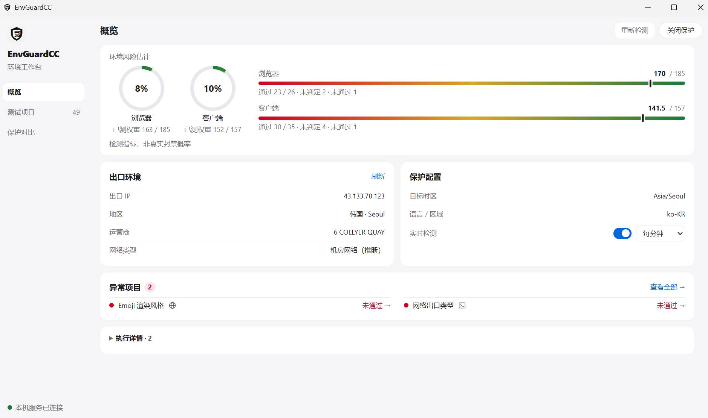
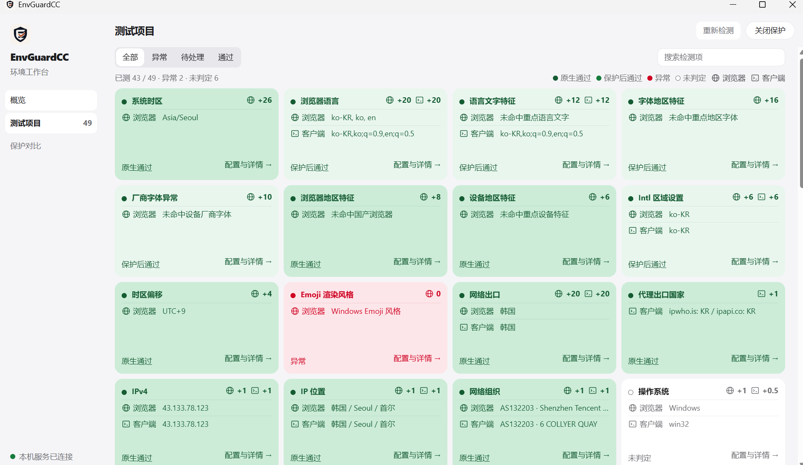
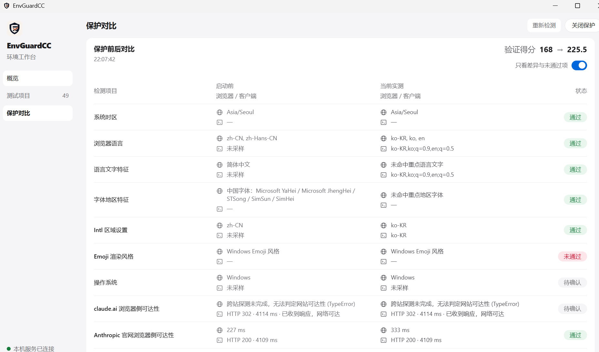

# EnvGuardCC

Claude 运行环境检测与保护工作台，支持浏览器与客户端环境分析、保护配置以及前后对比。

[English](README.en.md) · [GitHub](https://github.com/AACS111/EnvGuardCC) · [问题反馈](https://github.com/AACS111/EnvGuardCC/issues)

## 下载

- [Windows x64 安装包（.exe）](https://github.com/AACS111/EnvGuardCC/releases/download/v0.1.0/EnvGuardCC-Setup-0.1.0.exe)
- [Windows x64 便携包（.zip）](https://github.com/AACS111/EnvGuardCC/releases/download/v0.1.0/EnvGuardCC-Windows-x64.zip)
- [SHA-256 校验值](https://github.com/AACS111/EnvGuardCC/releases/download/v0.1.0/SHA256SUMS.txt) · [全部版本](https://github.com/AACS111/EnvGuardCC/releases)

安装包下载后直接运行；便携包请完整解压后运行 EnvGuardCC.exe，保留同目录运行文件。均已包含运行环境，无需另行安装 Node.js。安装包尚未进行代码签名。

## 界面预览

### 概览

查看浏览器与客户端的检测指标、出口环境、保护配置及异常项目。



### 测试项目

按全部、异常、待处理和通过筛选检测项，查看两端采样值与配置详情。



### 保护对比

对比启动前与当前实测结果，区分通过、未通过与待确认。



## 功能

- 浏览器与 Claude 客户端环境检测，覆盖时区、语言、字体、设备特征及网络出口。
- 出口 IP、地区、运营商和网络类型识别，未知结果保留为未判定。
- 启停环境保护、定时复检及逐项配置说明。
- 保护前后对比，展示原生通过、保护后通过、异常与未判定。
- 修改前保存原始配置，正常退出时尝试恢复；失败时保留备份和真实原因。
- Windows 桌面应用与本地网页运行模式。

检测指标仅用于环境分析，不代表真实封禁概率，也不保证账号或第三方服务可用性。

## 本地运行

需要 Node.js 20+、pnpm；Windows 桌面和系统设置操作使用 PowerShell 7。

```powershell
git clone https://github.com/AACS111/EnvGuardCC.git
cd EnvGuardCC
pnpm install
pnpm dev:electron
```

只运行本地网页：

```powershell
pnpm dev
```

启动后使用终端显示的本机地址。桌面模式使用本地 3030 页面端口；首次启动可能需要下载 Electron。

## 构建与验证

```powershell
pnpm lint
pnpm test:desktop
pnpm test:shutdown
pnpm test:protection
pnpm build
pnpm desktop:installer
```

桌面发布包名为 `EnvGuardCC-Windows-x64.zip`，具体目录见打包命令输出。

## 技术栈

Next.js 16、React 19、TypeScript、Tailwind CSS 4、Electron。

## 许可证

MIT，详见 [LICENSE](LICENSE)。
