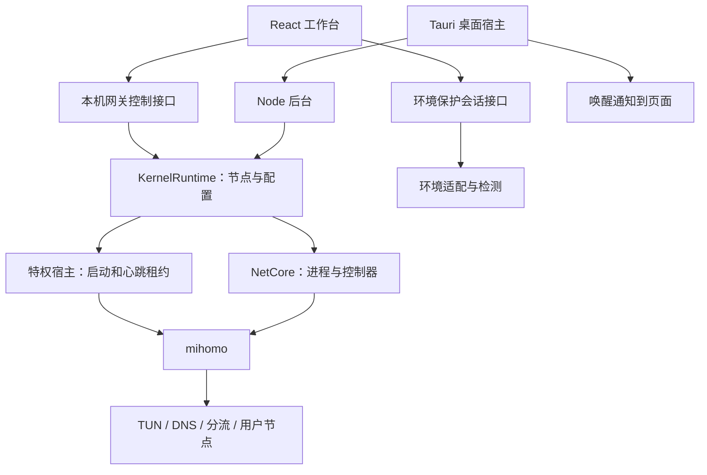
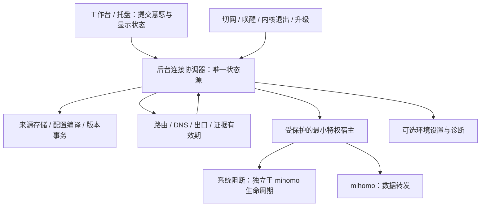
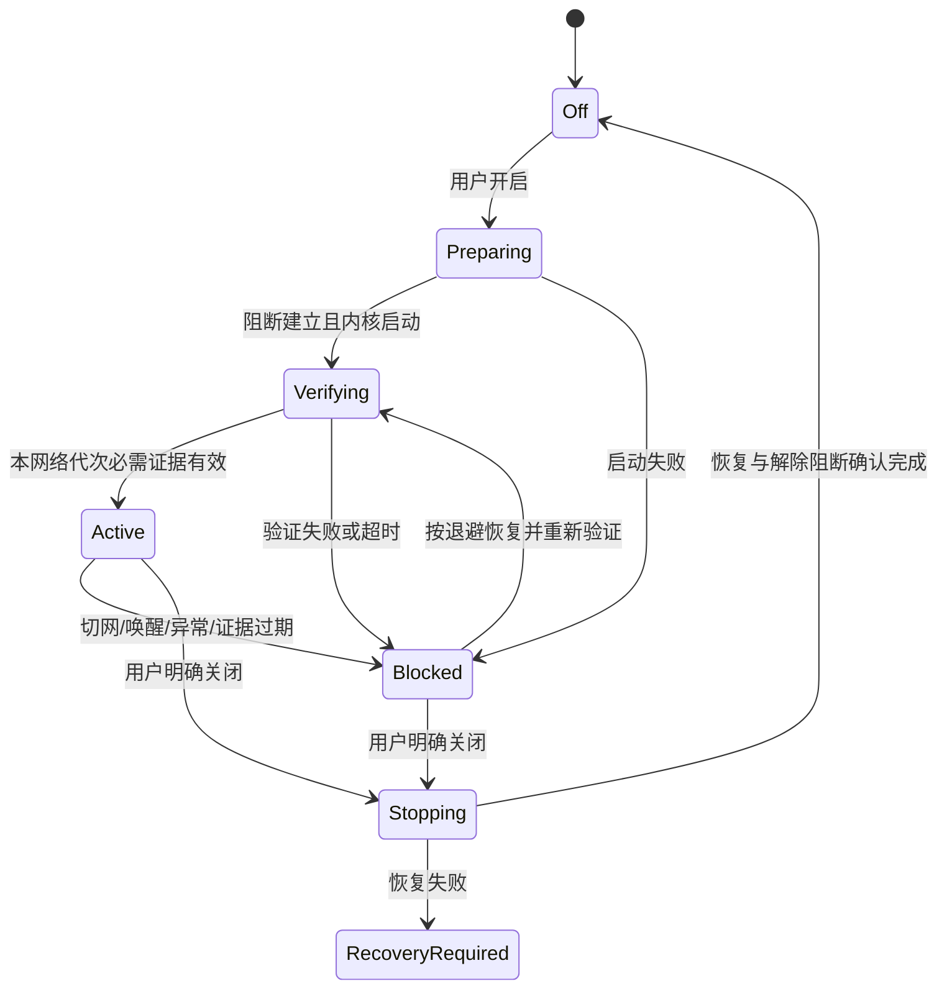

# EGCC 独立代理客户端与出差连接保护：架构评估和落地方案

评估日期：2026-11-07。基线：`develop`，HEAD `3c9f018`，包含评估时工作区中尚未提交的实现；不代表已发布版本。本次只新增方案，不修改现有功能，不安装宿主、不切换系统网络。

后续实施已经开始，以下保留原始评估基线；最新代码、macOS PF/TUN 实机测试与打包结果以[实现与验收记录](NETWORK-SAFETY-IMPLEMENTATION.md)为准。

## 1. 结论与可交付目标

EGCC 已具备独立代理客户端的基础：内置 mihomo、TUN、订阅导入、多来源、节点选择、测速、分流和桌面生命周期。继续沿用这一内核，优先补齐连接控制、系统阻断、配置事务和平台验收，具备替代 Clash 类客户端日常用途的可行性。现阶段不宜宣布已经可以放心卸载原客户端。

需要分别定义三个目标：

| 目标 | 可交付范围 | 判断依据 |
| --- | --- | --- |
| 日常代理 | 不依赖另一个代理客户端即可启动、导入自己的节点、分流和恢复网络 | 跨平台端到端验收 |
| 出差连接保护 | 切网、休眠、节点故障时，不静默恢复受保护流量的直连；明确展示故障与恢复 | 系统阻断与抓包证据 |
| Claude 账号保障 | 展示支持地区信息、减少意外连接变化、提供本地诊断记录 | 只能提供风险信息，不能承诺账号结果 |

**不能交付“在不支持地区保证正常使用 Claude 且不封号”。** Anthropic 的服务范围和账号处置由其决定。更换出口、调整时区或环境得分，都不能证明符合服务资格，也不能证明不会封号。固定节点并不意味着固定公网 IP；节点服务商可能更换出口。

官方资料核对：

- [Where can I access Claude?](https://support.claude.com/en/articles/8461763-where-can-i-access-claude)：应按官方当前支持范围核对访问地点。
- [Does Claude use my location?](https://privacy.claude.com/en/articles/11186740-does-claude-use-my-location)：安全与反滥用判断使用 IP 及其他信号；不能把出口 IP 当作唯一依据。
- [Safeguards warnings and appeals](https://support.claude.com/en/articles/8241253-safeguards-warnings-and-appeals)：列出多类账号封禁原因及官方申诉入口。诊断记录不能代替申诉结论。

检索还出现一份标注 2026-11-12 生效的地区政策，晚于本次评估日期，因此不将其作为已经生效的依据。产品应保存资料来源、核对时间与生效日期，避免把未来规则或过期快照当作当前规则。

## 2. 当前架构与成熟度



| 能力 | 当前证据 | 评估 |
| --- | --- | --- |
| 内置内核与供应链 | `scripts/net-core/vendor.mjs`、`kernel-manifest.json`、`third_party/mihomo/` | 已有固定版本、哈希与许可证基础；仍需安装包实机验收 |
| 订阅与来源 | `subscription.mjs`、`sources.mjs`、`runtime.mjs` | 已支持内联 Clash 节点和部分分享链接、多来源切换；不是完整 Clash 配置兼容 |
| TUN 与权限 | `config.mjs`、`host.mjs`、`host-install.mjs` | 已有接管探测；macOS 有应用内授权入口，Windows 仍需管理员安装流程 |
| 分流与固定出口 | `config.mjs` | Claude 专用手动组与普通流量组分开，方向合理；模式语义和规则有效性需补验收 |
| 状态与路由证据 | `routes.mjs`、`net-core-view.mjs` | 已区分无样本与违规；只能证明内核观察到的连接 |
| 退出与异常清理 | `guardian.cjs`、`host.mjs`、`desktop/backend.mjs` | 已有子进程回收与宿主租约；清理不是持续阻断 |
| 切网与唤醒 | `src-tauri/src/power.rs`、`protection-connection.mjs` | 有通知和重检基础，关键恢复仍依赖页面与环境会话 |
| 账号风险评分 | 检测及环境适配模块 | 可作环境分析；没有可校准的真实封禁概率模型 |

兼容边界应公开：`parseClashConfig()` 虽返回分组和规则，当前主要把节点与节点解析 DNS 导入自有配置；不能声称完整保留用户的策略组、规则集或 provider。分享链接解析与 YAML 内核协议支持也要分开列，不能因为 mihomo 支持某协议就声称对应分享链接已支持。

## 3. 应优先解决的具体缺口

以下分为代码已确认的问题和需要实机验证的边界。没有将注释、配置存在或单元测试通过当作系统级效果证明。

| 编号 / 优先级 | 代码依据与发现 | 影响和建议 |
| --- | --- | --- |
| G1 / P0 | `Detector.toggleProtection()` 先 `protection.act("start")` 再启用 TUN；`tunnel.ok=false` 在常规启动分支没有统一终止已开启的环境会话 | 开关可能开启而隧道未接管。把启动事务迁到后台，保护状态由网络证据决定 |
| G2 / P0 | `guardian.cjs` 在父进程失联后回收内核，`host.mjs` 在应用失联约 30 秒后停止内核；未找到独立于内核的系统阻断实现 | 不能据此宣称异常后零直连。增加独立的系统阻断，并区分正常退出与崩溃策略 |
| G3 / P0 | `NetCore.health()` 有恢复能力，但当前生产调用链未发现周期调用；后台开启的是订阅刷新、DNS 同步和心跳 | API 能用与持续健康不同。宿主管理连续探测、退避恢复和故障状态，不能依赖页面轮询 |
| G4 / P0 | `netCoreView()` 只将 `tunCaptured === false` 排除成功；当接管结果为 `null`，已有专用组连接仍可得到 `ok` | 未知接管状态会显示成功。要求接管证据明确为真且未过期，并限定结论范围 |
| G5 / P0 | `config.mjs` 生成的 Claude 通用域名规则先于对应 QUIC 拒绝规则 | 按顺序匹配时，前面的通用规则可能使拒绝规则无法命中。先解决规则优先级并验证实际 UDP/443 行为；本次未做真实 UDP 抓包 |
| G6 / P0 | `reloadFromFile()` 在选择器恢复失败时只写日志，仍返回选择器总数；配置重载先发生，恢复选择在后 | 固定出口可能在重载中短暂改变或落到默认节点。切换前阻断受保护流量，精确校验恢复结果，失败保持阻断 |
| G7 / P0 | 配置支持 `secret`，但生产创建配置与控制器时没有传入；生成配置复现为无控制器密钥 | 回环监听不能替代认证。本机进程可能修改配置或节点。生成运行期密钥，所有控制器调用统一认证 |
| G8 / P0 | 特权安装包装脚本引用传入的 Node、宿主脚本和内核路径；`resolveConfigPath()` 只做字符串目录约束，未见真实路径和符号链接验证 | 特权执行链需要专项审计：可执行内容须位于受管理员保护的位置，配置须语义白名单与路径校验；这是代码审计发现，未对本机安装权限做利用验证 |
| G9 / P1 | 内核快照仅包含已进入该内核的连接；`tunnelStatus()` 用单域名 fake-IP 解析判断接管 | 未见内核外流量不等于不存在。增加系统路由、双栈、接口、DNS 和受控端点回执的交叉验证 |
| G10 / P1 | `ProtectionSession.performTest()` 对出口变化默认重新适配；订阅来源在所选节点消失时会选择第一条；固定 `select` 不能约束供应商公网出口 | 严格会话应把未授权出口变化变成暂停条件，不能静默接受新出口或自动改环境来掩盖变化 |
| G11 / P1 | `proxyServerDns` 当前存于节点文件顶层，而非每个来源；切换来源主要切换节点和选择值 | 多来源可能携带错误的 DNS 提示。解析器及节点缓存随来源隔离与迁移 |
| G12 / P1 | `exit-history.mjs` 用去重 IP 数量减一表示变化次数 | A→B→A 实际两次变化会计为一次。按相邻观测转换计数，区分检测来源、时间、有效期和空白区间 |
| G13 / P1 | `probeExitCountry()` 经默认混合端口请求 `ipwho.is`；该域名不属于 Claude 置顶目标，在规则/全局模式下会匹配普通流量兜底组 | 测到的可能是普通组出口，不能当作 Claude 固定组出口。为固定组建立专用探测路径，并把每次观测绑定到实际代理链和网络代次 |

另外：`direct` 模式仍有 Claude 置顶代理规则，并非通常理解的“全部直连”。应显式定义“关闭日常代理”与“停止出差保护”的关系，界面、配置和文档使用相同语义。

`ipv6: false` 是内核配置，不足以证明物理网卡没有 IPv6 旁路；`strict-route` 也不能替代内核退出后的系统阻断。公共 DNS 的 GeoIP 地区、运营商名称、代理外层 TLS 指纹，不应被包装成服务端账号安全证据。DNS 的首要指标应是解析正确、隐私边界明确、路径可验证和故障可恢复。

## 4. 推荐目标架构

沿用 Tauri + React + mihomo，保留网关作为可选诊断/API 入口。新增一个后台连接协调器，将网络会话与环境适配分开，环境适配不能控制网络保护成功与否。默认保持用户原有系统环境；确有用户需求的时区/语言设置单独授权和恢复，不作为网络保护前提。



### 控制与数据边界

1. **协调器**：处理启动、关闭、模式切换、配置更新与恢复；所有变更串行，带操作 ID 和网络代次，丢弃旧网络的晚到结果。
2. **特权宿主**：仅提供有限结构化操作，不接受任意命令；管理员保护可执行文件、依赖及其父目录。优先使用带调用方验证的本机 IPC；过渡期回环 HTTP 必须认证。Windows 单独落实 ACL，不能把 POSIX `0600` 当作 Windows 权限保证。
3. **配置事务**：候选解析、内核校验、建立阻断、应用与恢复选择、验证成功、提交持久状态；失败恢复上一版本，无法恢复时保持阻断并提供诊断。
4. **数据转发**：普通流量可故障转移；严格会话使用用户明确选定的节点和经过确认的出口基线，不自动跨出口切换。
5. **证据服务**：每条证据携带观测范围、时间、网络代次与来源；控制器快照、系统路由、端点回执分别展示，不能互相替代。普通组和固定组分别探测出口，禁止把“请求经过本机混合端口”自动解释成“经过固定组”。

### 系统阻断的实现路线

Windows 评估以 WFP 为基础的过滤策略；macOS 先验证独立 PF anchor 的可行性与边界，再比较 Network Extension 所需的签名、权限和分发条件。这里是候选技术路线，不能在未经原型和实机验收前承诺可用。

阻断规则必须在故障发生前生效，并覆盖 IPv4/IPv6 与新增物理网卡。仅凭轮询后补一条域名规则无法消除空窗；域名 IP 清单也无法覆盖缓存、共享 IP、DoH 和纯 IP 请求。第一版严格模式宜采用“公网流量仅允许经隧道，显式放行必要的引导与局域网”，并清楚说明这会限制普通分流和应用联网。

如果需要保持普通应用自由直连，再单独验证按应用阻断的能力；共享浏览器、子进程与多个用户会话都要纳入，不能把支持桌面应用自动等同于覆盖任意浏览器标签页。平台能力不足时显示不支持严格保护，不能静默降级。

引导例外只允许核验过的节点连接、最低限度解析和用户显式允许的内网服务。限制进程、目的地址、端口和有效期，避免因为需要更新订阅就放开通用公网。紧急解除与卸载必须可达，所有规则有归属标记且只移除 EGCC 自己的规则。

### 网络状态机



严格模式下，正常退出要明确结束保护并恢复网络；崩溃、后台失联、内核重启和升级期间保留阻断，宿主继续维护状态。改变当前“失联就停内核”的策略时，要同时交付本地恢复工具，防止用户永久断网。宿主自身退出后的持久规则行为也必须验收，不能仅覆盖子进程崩溃。

`Active` 的网络条件建议为：阻断已安装、内核运行、TUN 系统路由及探测有效、必要 DNS 路径有效、实际代理链符合配置、出口验证未过期。没有业务连接时，只能显示“连接就绪，尚无业务路由样本”。成功只说明这些技术条件成立，绝不扩展为 Claude 已认可账号或地区资格。

## 5. 用户体验与出差场景

工作台优先展示连接状态、代理范围、当前出口、故障原因和下一步操作。环境检测放在诊断中。建议提供两个明确选项：日常代理、出差严格保护；同时展示各平台实际支持范围。

- **首次使用**：导入用户自己的订阅或自托管节点 → 系统授权 → 验证连接 → 展示接管范围与限制。不提供或硬编码私人代理服务。
- **切换 Wi-Fi/热点/有线**：后台先使旧证据失效；保持严格阻断，验证新网络后恢复。页面关闭、最小化或隐藏不影响执行。
- **合盖和唤醒**：允许正常休眠；不能依赖防休眠代替恢复机制。唤醒后重新核验路由、解析、出口及规则有效性。
- **酒店/机场认证门户**：单独进入有倒计时的联网认证状态，明确当前尚未受保护；仅放行最小认证流程。若无法可靠隔离，保持保护暂停并提示手动处理，不暗中放开所有流量。
- **公司 VPN 与内网**：保留已有的内网豁免；新增豁免需说明范围，不能覆盖受保护目标。冲突时提供诊断，不自动关闭严格路由。
- **节点或出口改变**：严格模式暂停；显示变化的证据，由用户明确接受新的基线。普通流量组可独立恢复，不声称固定节点等于固定公网出口。
- **地区信息**：将用户实际出差地点与代理出口分别展示；出口 GeoIP 不能证明实际所在地。提供官方支持范围及人工核对入口，不用选择某出口来自动宣称地区符合要求。
- **服务拒绝访问**：区分联网失败、DNS 错误、认证错误、地区提示、服务限流与账号状态。保留脱敏诊断与官方申诉入口，不自动反复登录、切节点或重置客户端数据。

## 6. 分阶段实施与验收门槛

按依赖顺序交付，每阶段用验收结果决定是否进入下一阶段；没有实机数据前不承诺具体工期。

| 阶段 | 主要交付 | 重点代码位置 | 完成门槛 |
| --- | --- | --- | --- |
| A：状态与控制正确 | 解决 G1、G3～G8；增加后台协调器、控制器认证、严格证据判定、规则顺序、选择恢复失败处理及特权路径审计 | `desktop/backend.mjs`、`scripts/net-core*`、`Detector.tsx`、`net-core-view.mjs` | 授权取消、接管未知、重载失败、配置无效均不能显示保护成功；隐藏页面不停止监测 |
| B：独立代理可日用 | 来源 DNS 隔离、订阅更新与模式切换事务；定义配置兼容矩阵；Windows 授权和系统代理设置/恢复；托盘、启动策略与脱敏诊断 | `sources.mjs`、`subscription.mjs`、`runtime.mjs`、Tauri 与安装器 | 不运行 Clash，使用自有订阅或自托管节点，在两平台完成安装、连接、刷新、切换、退出与恢复。通过后才能声明日常替代范围 |
| C：出差严格保护 | 先交付一个平台的阻断原型和恢复工具，再完成第二平台；实现 G2、G9、G10、G12、G13，网络代次、严格出口基线、认证门户流程 | 最小特权宿主、系统阻断适配层、协调器、证据模块 | 持续发包和故障注入时，无未授权公网直连；唤醒与切网先验证后恢复；故障状态始终可解释且可恢复 |
| D：开源交付与稳定化 | 自托管文档、无账号测试环境、兼容性/长稳测试、许可证分发、签名安装包、宿主升级及卸载回归 | `CONTRIBUTING.md`、平台文档、构建和 CI | 发布物能复现测试结论，列明支持平台和未覆盖场景；不把开发分支自动当正式发布 |

建议第一轮实现范围为 A，另做 C 的单平台阻断可行性验证；不要先增加更多环境伪装或分数。若阻断技术无法满足目标，应尽早缩小出差保护声明，而非等完整 UI 做完后再发现能力缺口。

## 7. 测试与可观测性

单元测试负责状态机、认证、配置事务、规则顺序、源隔离和计数；真实内核测试负责接口、选择器、热加载及生命周期；系统保护必须通过独立的实机测试。

| 故障或场景 | 需要观察的结果 |
| --- | --- |
| 冷启动、取消授权、宿主不可达 | 不误报成功，原网络状态可恢复 |
| 从 Wi-Fi 切热点/有线、多网卡并存 | 新旧接口都受预置阻断约束；旧探测不能解锁新网络 |
| 休眠、合盖、解锁、关机重启 | 唤醒第一批流量也受规则约束；恢复不依赖页面激活 |
| 强杀 UI、后台、mihomo、特权宿主 | 分别验证，不只杀一个进程；严格模式阻断与恢复工具行为符合声明 |
| 节点掉线、订阅更新删除当前节点、DNS 故障 | 不静默切换严格出口；普通流量故障转移可单独工作 |
| 热加载、模式切换、升级、回滚 | 切换空窗有阻断，失败不提交新状态，选择恢复失败可见 |
| IPv4/IPv6、UDP/QUIC、DoH/DoT、已建立连接 | 同时验证 TUN 内与物理接口，不能只看 A 记录或单次 HTTP 请求 |
| 认证门户、公司 VPN、内网 DNS | 仅放行声明的范围；关闭与卸载只恢复 EGCC 所有的规则 |
| 未知证据、过期证据、无业务连接 | 分别显示未知、过期、无样本，不出现绿色通过 |

验收使用无账号、无真实对话的受控接收端：持续记录测试包和请求来源，同时在物理接口抓包。允许的节点外层连接、引导流量与内网例外要事先列明；“无泄漏”仅指未授权直连为零，不能把经节点的外层包算作泄漏。记录网络代次、状态转换、规则版本、阻断结果及恢复时间；报告具体平台和网络条件，不能从有限测试推导所有网络均安全。

本地诊断默认不包含订阅完整 URL、密码、节点凭证、Authorization、Cookie、账号信息或对话正文；导出先脱敏并允许用户预览。订阅和凭证保留在用户机器，提供可替换/自托管的探测端点及离线诊断，不把某个第三方 IP 情报站的可用性作为基础代理功能启动的必要条件。

## 8. 本次验证记录和限制

运行环境：本机 macOS，Node `v22.23.2`，pnpm `10.34.5`。本次执行：

```sh
node --test --test-timeout=60000 scripts/check-kernel-config.mjs scripts/check-net-core-sources.mjs scripts/check-net-core-store.mjs scripts/check-protection-reconnect.mjs scripts/check-protection-session.mjs
```

结果：57 个测试通过，0 失败，0 跳过。验证范围是配置、来源存储及隔离/模拟的恢复会话行为，不是 Windows、特权宿主或真实 TUN 的系统级验收。

另用纯函数复现确认：

- `tunEnabled=true`、`tunCaptured=null`、存在专用组连接时，当前视图模型返回 `ok`。
- 默认生成配置中，`claude.ai` 通用规则索引为 1，QUIC 拒绝规则索引为 6；存在前置通用匹配。
- 不传 `secret` 时生成配置不含控制器密钥，生产运行时当前使用该路径。

本次未执行完整 lint/build/Rust/浏览器验证，未启动真实 TUN、未安装或改动防火墙、未使用 Claude 账号测试、未验证 Windows 安装包。上述问题没有在本次修复；此文档是后续实施和验收的基线。
